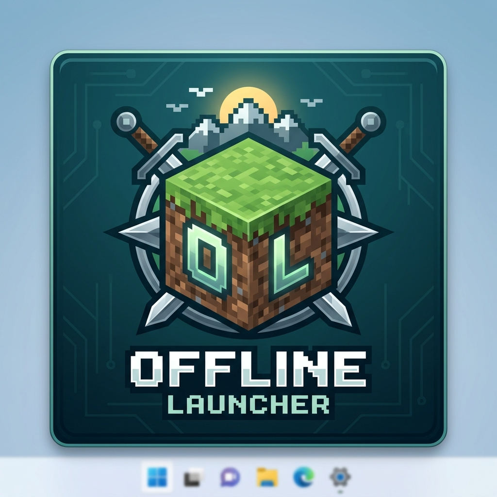

# OfflineLauncher

A cross-platform Minecraft Java Edition launcher with first-class offline account support, built with Tauri 2, React, TypeScript, and Rust.

## Features

- **Offline Accounts**: Create and manage offline accounts with vanilla-compatible UUID generation
- **Version Management**: Browse, filter, and download Minecraft versions (releases, snapshots, old_beta, old_alpha)
- **Java Runtime Management**: Auto-detect system Java, download required versions (Mojang/Adoptium)
- **Instances (Profiles)**: Isolated game directories with custom settings per instance
- **Mod Loader Support**: Fabric and Quilt installation with version merging
- **Modern UI**: Clean, dark-themed interface with light mode toggle
- **Real-time Progress**: Streaming download and launch progress
- **Cross-platform**: Windows, macOS, and Linux support

## Architecture

```
OfflineLauncher/
├── src-tauri/                 # Rust backend
│   ├── src/
│   │   ├── accounts/          # Account management (offline + provider trait)
│   │   ├── versions/          # Version manifest, JSON parsing, inheritance
│   │   ├── downloads/         # Concurrent downloader with resume/retry/SHA1
│   │   ├── java/              # Java detection, runtime management
│   │   ├── instances/         # Instance/profile management
│   │   ├── launch/            # Argument substitution, classpath, process spawning
│   │   ├── loaders/           # Fabric/Quilt integration
│   │   ├── config.rs          # TOML configuration
│   │   ├── app_dirs.rs        # Platform-correct data directories
│   │   ├── events.rs          # Tauri event definitions
│   │   └── error.rs           # Error types
│   ├── Cargo.toml
│   └── tauri.conf.json
├── frontend/                   # React + TypeScript frontend
│   ├── src/
│   │   ├── components/        # Reusable UI components
│   │   ├── pages/             # Page components (Home, Accounts, Versions, Instances, Settings)
│   │   ├── hooks/             # Custom React hooks
│   │   ├── services/          # Tauri API wrappers & event listeners
│   │   ├── store/             # Zustand state management
│   │   ├── types/             # TypeScript types (shared with Rust)
│   │   └── styles/            # Tailwind CSS
│   ├── package.json
│   ├── vite.config.ts
│   └── tailwind.config.js
├── tests/                      # Rust tests
├── .github/workflows/          # CI/CD
└── Cargo.toml                  # Workspace root
```

## Getting Started

### Prerequisites

- **Rust** (latest stable) - [rustup.rs](https://rustup.rs/)
- **Node.js** (18+) and **npm** - [nodejs.org](https://nodejs.org/)
- **Tauri prerequisites** - [tauri.app/start/prerequisites](https://tauri.app/start/prerequisites/)

### Installation

```bash
# Clone the repository
git clone https://github.com/donoigabriel6-a11y/OfflineLauncher.git
cd OfflineLauncher

# Install frontend dependencies
cd frontend
npm install

# Build the application
cd ..
cargo tauri build
```

### Manual build on Windows

You can build the launcher locally without GitHub Actions.

**Install these prerequisites first:**

1. Git for Windows.
2. Node.js 20 LTS (includes npm).
3. Rust stable with the MSVC toolchain. Install Visual Studio Build Tools with **Desktop development with C++** (MSVC and the Windows SDK).
4. WebView2 Runtime (normally already installed on Windows 10/11).
5. The Tauri CLI:
   ```powershell
   cargo install tauri-cli --version "^2" --locked
   ```

**Clone and build:**

Open PowerShell in the folder where you want the source:

```powershell
git clone https://github.com/donoigabriel6-a11y/OfflineLauncher.git
cd OfflineLauncher

# Install frontend packages
cd frontend
npm ci
cd ..

# Check and compile the Rust workspace
cargo check --workspace
cargo test --workspace

# Build the Windows installer/bundle
cargo tauri build
```

The Tauri configuration runs the frontend production build automatically. Build artifacts are written under `src-tauri/target/release/bundle/` (for example, the Windows installer under `msi/` or `nsis/`, depending on enabled bundle targets).

**Run in development mode instead:**

```powershell
cd frontend
npm ci
cd ..
cargo tauri dev
```

If you only want to verify Rust compilation before making a full installer, run `cargo check --workspace`. If you want strict lint checking, run:

```powershell
cargo fmt --all -- --check
cargo clippy --workspace --all-targets --all-features -- -D warnings
```

On Linux or macOS, install the platform-specific Tauri system prerequisites before running the same Cargo commands. See the [official Tauri prerequisites guide](https://v2.tauri.app/start/prerequisites/).

### Development

```bash
# Start development server (frontend + backend)
cargo tauri dev
```

This will:
1. Start the Vite dev server on http://localhost:1420
2. Compile and run the Tauri application
3. Enable hot-reloading for both frontend and backend

## Project Structure

### Backend (Rust)

The Rust backend is organized into clear modules:

| Module | Purpose |
|--------|---------|
| `accounts` | Account trait, OfflineAccount implementation, UUID generation, JSON storage |
| `versions` | Version manifest fetching, JSON parsing, library rules, inheritance resolution |
| `downloads` | Concurrent downloader (8 default), resume, retry, SHA1 verification, progress events |
| `java` | System Java detection, Mojang/Adoptium runtime downloads, version selection |
| `instances` | Profile management with isolated game directories |
| `launch` | Placeholder substitution, argument parsing, classpath, process spawning |
| `loaders` | Fabric/Quilt API integration, installer profile generation |
| `config` | TOML-based configuration with defaults |
| `app_dirs` | Platform-correct data directories (Windows: AppData, macOS: ~/Library, Linux: ~/.local/share) |

### Frontend (React + TypeScript)

- **State Management**: Zustand with persistence
- **Routing**: React Router v6
- **Styling**: Tailwind CSS with dark/light theme
- **Components**: Modular UI components (Button, Input, Card, Modal, Select, Toast)
- **API Layer**: Type-safe Tauri invoke wrappers
- **Events**: Real-time Tauri event listeners

## Offline Account UUID Generation

Offline accounts use UUID v3 (MD5 namespace) matching vanilla Minecraft exactly:

```rust
// Input: "OfflinePlayer:<username>"
// Namespace: MD5 hash
// Version: 3 (UUID v3)
// Variant: RFC 4122

fn generate_offline_uuid(username: &str) -> Uuid {
    let input = format!("OfflinePlayer:{}", username);
    let hash = md5::compute(input.as_bytes());
    Uuid::from_bytes(*hash)
}
```

Example: Username "Steve" → UUID `8667ba71-b85a-3340-af54-457a9734eed7`

## Adding a New Account Provider

The `Account` trait in `src-tauri/src/accounts/model.rs` is designed for extensibility:

```rust
#[async_trait]
pub trait Account: Send + Sync {
    fn id(&self) -> Uuid;
    fn username(&self) -> &str;
    fn uuid(&self) -> Uuid;
    fn access_token(&self) -> &str;
    fn user_type(&self) -> UserType;
    fn account_type(&self) -> AccountType;
    fn skin_path(&self) -> Option<&PathBuf>;
    fn created_at(&self) -> DateTime<Utc>;
    fn updated_at(&self) -> DateTime<Utc>;
    async fn set_username(&mut self, username: String) -> Result<()>;
    async fn set_skin_path(&mut self, path: Option<PathBuf>) -> Result<()>;
}
```

To add a new provider (e.g., Microsoft/Xbox):

1. Create a new struct implementing `Account` (e.g., `MicrosoftAccount`)
2. Add the new variant to `AccountType` enum
3. Implement OAuth2 flow in a new module
4. Update `AccountStorage` to handle the new type
5. Add Tauri commands for authentication
6. Update frontend to support the new login flow

The trait-based design ensures the launch pipeline works with any provider seamlessly.

## Configuration

The launcher stores configuration in:
- **Windows**: `%APPDATA%\OfflineLauncher\config.toml`
- **macOS**: `~/Library/Application Support/OfflineLauncher/config.toml`
- **Linux**: `~/.config/OfflineLauncher/config.toml`

Key settings:
```toml
concurrent_downloads = 8
default_memory_mb = 2048
default_java_version = 21  # optional
theme = "dark"  # dark, light, system
close_on_launch = false
```

## Building for Distribution

```bash
# Build for current platform
cargo tauri build

# Build for specific targets
cargo tauri build --target x86_64-pc-windows-msvc
cargo tauri build --target x86_64-apple-darwin
cargo tauri build --target x86_64-unknown-linux-gnu
```

Outputs:
- **Windows**: `.msi` installer, `.exe` portable
- **macOS**: `.dmg`, `.app` bundle
- **Linux**: `.AppImage`, `.deb`

## Testing

```bash
# Run all Rust tests
cargo test --all

# Run specific test modules
cargo test accounts::uuid
cargo test launch::arguments
cargo test versions::library

# Run integration tests (downloads a test version)
cargo test --test integration_test
```

## Contributing

1. Fork the repository
2. Create a feature branch
3. Make your changes
4. Run tests and linting: `cargo fmt --all -- --check && cargo clippy --all-targets --all-features -- -D warnings`
5. Submit a pull request

## License

MIT License - see [LICENSE](LICENSE) for details.

## Acknowledgments

- [Mojang](https://mojang.com/) for Minecraft
- [FabricMC](https://fabricmc.net/) for Fabric loader
- [QuiltMC](https://quiltmc.org/) for Quilt loader
- [Tauri](https://tauri.app/) for the framework
- [Adoptium](https://adoptium.net/) for Temurin JDK builds
